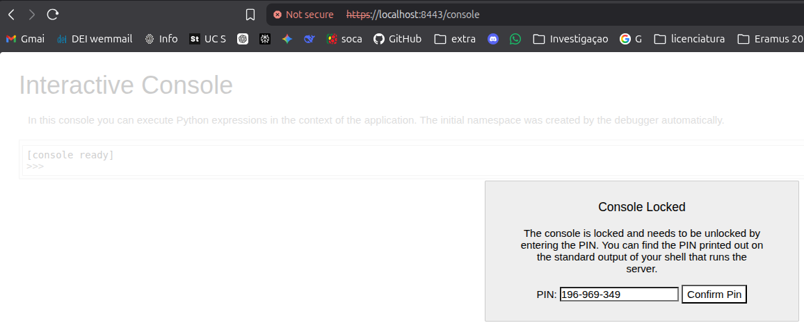
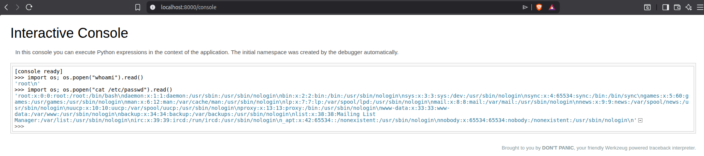
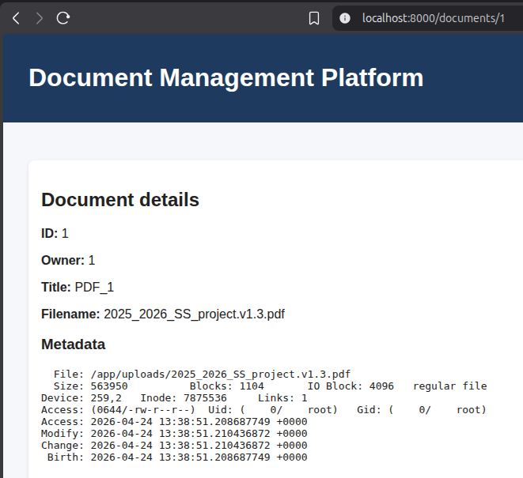
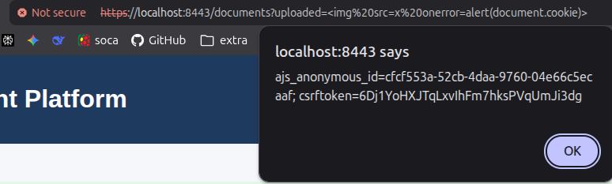
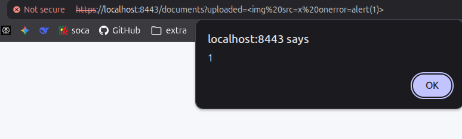
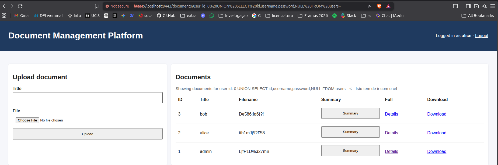
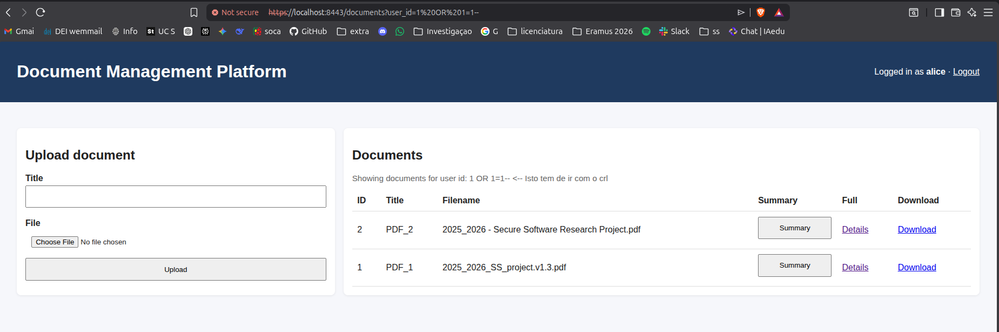
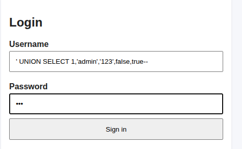
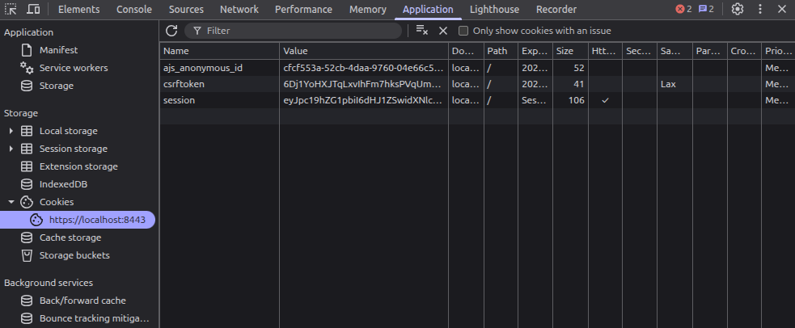

# Vulnerabilities Found in the Baseline Code

## Reconnaissance : Attack Surface Mapping

Before analysing the source code, we performed a reconnaissance step using `dirsearch` to map the application's exposed endpoints.

**Results:**
```
[23:23:35] 200 -    2KB - /console
[23:23:35] 302 -   199B - /documents  ->  /login
[23:23:36] 200 -    21B - /health
[23:23:37] 200 -   845B - /login
[23:23:37] 302 -   199B - /logout  ->  /login
```

**Findings:**
- `/console` — Flask interactive debugger publicly accessible (HTTP 200) — **critical**
- `/health` — publicly accessible without authentication, returns `{"status": "ok"}`, confirming the app is running (minor information disclosure)
- `/login`, `/logout`, `/documents` — attack surface mapped for further analysis

The following vulnerabilities were identified through manual source code analysis and dynamic testing of the baseline application.

---

## Vulnerability 1 - Flask Debug Mode Enabled

The application is running with Flask's debug mode turned on (`debug=True` in `web/run.py:6`). This is something that's common to leave on during development but should never reach production.

We first noticed this during the dirsearch scan, which showed `/console` returning a 200 OK, that endpoint shouldn't exist in a production app. 
When we started the Docker containers, the terminal immediately printed the debugger PIN in plaintext:
```
web-1  |  * Debugger is active!
web-1  |  * Debugger PIN: 359-404-629
```

A single line in `web/run.py:6` confirmed it:
```python
app.run(host="0.0.0.0", port=8000, debug=True)
```

**Impact:** Anyone who gets hold of that PIN — from the logs, or by brute-forcing it — can open `/console` and run arbitrary Python code on the server: full access to the filesystem, the database, environment variables.

**SR Violated:** SR-15 (Error Handling and Logging)

**Fix:** Set `debug=False` in production, ( TO DO...)

**Exploit:**

To exploit this, we navigated to `http://localhost:8000/console`. The page immediately asks for a PIN, which was already visible in the Docker terminal output when the app started. After entering the PIN, we had access to a live Python interpreter running inside the server.



We then ran two commands to demonstrate the impact



The process runs as `root` inside the container, so whoever has access to that console has complete control over the server.

---

## Vulnerability 2 - Passwords Stored in Plaintext

The first sign was in `db/init.sql` — the seed data inserts user passwords as plain strings with no hashing:

```sql
INSERT INTO users (username, password, is_disabled) VALUES
('admin', 'L|fP1D%327mB', FALSE),
('alice', 'tth1mJj5?£58', FALSE),
('bob', 'De586:Iq6}?!', FALSE);
```

Checking `web/app/app.py:96` confirmed that the login logic doesn't hash anything either — it does a direct string comparison between the submitted password and whatever is stored in the database:

```python
if user and (user[2] == password and not user[3]) or is_admin:
```

Additionally, the condition mixes `and` and `or` in a way that makes the authentication logic difficult to reason about and potentially error-prone.

**Impact:** If an attacker gets read access to the database, all passwords are immediately exposed with no cracking needed.

**SR Violated:** SR-6 (Authentication and Password Management)

**Fix:** Passwords should be hashed ( TO DO ...)

---

## Vulnerability 3 - Insecure Direct Object Reference (IDOR)

While logged in as Alice, we noticed the document detail page follows a predictable URL pattern: `/documents/<id>`. Changing the ID to one belonging to another user returned their document with no error, no redirect, nothing.

In `web/app/app.py:111`, the `document_details` route has no `@login_required` decorator and no ownership check. The source even has a comment acknowledging it:

```python
@app.route("/documents/<int:document_id>")
def document_details(document_id):
    # intentionally missing authorization check
    cur.execute(...)
```

The app fetches whatever document matches the ID and returns it, regardless of who's asking or whether they're even logged in.

**Exploit:**

Logged in as Alice, we changed the document ID in the URL from `/documents/2` to `/documents/1` and got access to a document belonging to another user. We also confirmed this works without any authentication at all - opening the URL in an incognito window with no session returned the document just the same.



**Impact:** Any user — or unauthenticated visitor — can access documents that don't belong to them by guessing or enumerating IDs.

**SR Violated:** SR-4 (Access Control)

**Fix:** Add `@login_required` t, verify ... ( to do ...)

---

## Vulnerability 4 - Cross-Site Scripting (XSS)

After uploading a document, the app redirects to `/documents?uploaded=<title>`, and the title gets displayed on the page as a confirmation message. Since the value comes straight from the URL, we tried replacing it with an HTML payload.

In `web/static/script.js:14`, the `uploaded` parameter is read from the URL and written directly into the DOM via `innerHTML`, with no sanitization:

```js
li.innerHTML = `Document uploaded: ${title}`;
```

Since `innerHTML` interprets its input as HTML, any payload in that parameter gets executed by the browser.

**Exploit:**

Payload 1 — simple alert to confirm execution:
```
/documents?uploaded=
```

Payload 2 — steals the session cookie:
```
/documents?uploaded=
```

Both worked. An attacker can craft one of these URLs and send it to a logged-in user — if they click it, any JavaScript in the payload runs in their browser with their session.





**Impact:** An attacker can steal session cookies and hijack authenticated sessions, or perform actions on behalf of the victim.

**SR Violated:** SR-7 (Input Validation and Output Encoding)

**Fix:** Replace `innerHTML` with `textContent`, which treats the value as plain text and never executes it as HTML.

---

## Vulnerability 5 - SQL Injection (Document Listing)

On the documents page, the URL accepts a `user_id` parameter: `/documents?user_id=2`. We noticed this was being used to filter which documents to show, so we tried passing SQL instead of a number.

The problem is in `web/app/app.py:47-55`. The `get_documents_for_user` function builds the query using Python's `%` string formatting directly with the user-supplied value — no parameterization:

```python
query = f"""
    SELECT id,title,filename,uploaded_at
    FROM documents
    WHERE owner_id=%s
    ORDER BY uploaded_at DESC
""" % owner_id
```

This also applies to any query going through `utils.prepare_query` (`web/app/utils.py:16`), which does the exact same thing:

```python
def _log_query(sql, params):
    return sql % params
```

**Exploit:**

Payload 1 — returns all documents from all users:
```
/documents?user_id=1 OR 1=1--
```

Payload 2 — dumps usernames and passwords directly into the document list:
```
/documents?user_id=0 UNION SELECT id,username,password,NULL FROM users--
```





**Impact:** An attacker can read any data in the database, including credentials from other users.

**SR Violated:** SR-5 (Input Validation) / SR-8 (Database Security)

**Fix:** Use proper parameterized queries with `psycopg2` — pass values as a tuple to `cur.execute()`, never via string formatting. Remove the `prepare_query` helper entirely.

---

## Vulnerability 6 - SQL Injection (Login)

After finding SQL injection in the documents page, we checked the login form next. The username field turned out to be equally vulnerable. The query in `web/app/db.py:4` is built using `prepare_query`, which as shown above just does string formatting:

```python
query = utils.prepare_query("SELECT id, username, password, is_disabled FROM users WHERE username='%s'", username)
```

**Exploit:**

By entering the following in the username field and `123` as the password, we bypassed authentication entirely and logged in as admin:

```
Username: ' UNION SELECT 1,'admin','123',false,true--
Password: 123
```

The injected query returns a fake row with a known password, and since the app compares `user[2] == password`, the check passes.



**Impact:** Full authentication bypass. An attacker can log in as any user without knowing their password.

**SR Violated:** SR-5 (Input Validation) / SR-6 (Authentication and Password Management)

**Fix:** Same as above — parameterized queries. The `prepare_query` function should be replaced with standard `cur.execute(sql, params)` calls throughout.

---

## Vulnerability 7 - Session Cookie Readable and Unsigned

While testing the application, we opened the browser dev tools (F12 → Application → Cookies) and found the session cookie. The value looked like base64, so we decoded it:

```bash
echo "eyJpc19hZG1pbiI6dHJ1ZSwidXNlcl9pZCI6MSwidXNlcm5hbWUiOiJhZG1pbiJ9" | base64 -d
{"is_admin":true,"user_id":1,"username":"admin"}
```

The full session state is readable without any server interaction. On top of that, the secret key used to sign the cookie is `dev-secret-key` (hardcoded in `.env`), which means an attacker who knows it can also forge valid session cookies for any user.



**Impact:** Session contents are exposed to anyone who can read the cookie. With the weak secret key, an attacker can craft a cookie with `"is_admin": true` or any other `user_id` and the server will accept it as legitimate.

**SR Violated:** SR-3 (Session Management)

**Fix:** Use a strong, randomly generated secret key stored as an environment variable — never committed to the repository. Consider also setting `SESSION_COOKIE_HTTPONLY=True` and `SESSION_COOKIE_SECURE=True` to reduce exposure.

---

## Vulnerability 8 - Sessions Never Expire


**Impact:** A stolen session cookie remains valid forever. On shared machines, sessions left open are never automatically cleaned up.

**SR Violated:** SR-3 (Session Management)

**Fix:** ( TO DO)::

---

## Vulnerability 9 - Command Injection (File Upload)

When a file is uploaded, the application runs `stat` on the saved file to extract metadata. In `web/app/app.py:58-59`, the filename is passed directly into a shell command via `utils.build` and `utils.call`:

```python
def extract_metadata(filename):
    cmd = utils.build("stat ", str(filename), " 2>&1")
    return utils.call(cmd)
```

`utils.call` uses `os.popen()`, which passes the command to the shell. The `sanitize_filename` function in `utils.py` only strips null bytes and normalizes slashes — it does not remove shell metacharacters like `;`, `|`, or `$()`.

**Exploit:**

Uploading a file with a crafted name such as:
```
exploit; whoami
```
causes the shell to execute `whoami` as a separate command after `stat`. Any shell command can be injected this way.

**Impact:** Remote code execution on the server. An authenticated user can run arbitrary commands as the application user.

**SR Violated:** SR-5 (Input Validation)

**Fix:** Avoid passing filenames to the shell entirely. Use Python's `os.stat()` instead of calling `stat` via the shell. If shell execution is truly needed, use `subprocess.run()` with a list of arguments (not a string) so the shell never interprets the input.

---

## Observation - File Management

The application has no restrictions on what files can be uploaded. Any file type is accepted, there is no size limit, and the original filename provided by the user is used directly without meaningful sanitization. There is also no mechanism to control what gets stored or served from the upload directory.

**SR Violated:** SR-11 (File Management)

**Fix:** Restrict accepted file types to an allowlist, enforce a size limit, and generate server-side filenames instead of using the one provided by the user.

---

## Observation - Communications Security

The application has no transport-layer security in place. Traffic runs over plain HTTP, meaning credentials and session cookies are sent unencrypted over the network. There are also no security-related HTTP headers configured.

**SR Violated:** SR-14 (Communications Security)

**Fix:** Deploy behind HTTPS with a valid certificate and add security headers such as `Strict-Transport-Security`. Session cookies should also have the `Secure` flag set.

---

## Observation - False Sense of Input Sanitization

The codebase has two functions in `web/app/utils.py` that suggest sanitization is being handled — `sanitize_filename` and `prepare_query` — but neither actually protects against anything meaningful.

`sanitize_filename` only strips null bytes and normalizes slashes. It doesn't block dangerous extensions, path traversal sequences, or shell metacharacters. On top of that, its output isn't even used when saving the file to disk — the original unsanitized filename is used instead.

`prepare_query` sounds like it validates or escapes SQL input, but it just does Python string formatting (`sql % params`), which is exactly what makes SQL injection possible throughout the app.

The presence of these functions gives a false impression that input is being handled safely, when in reality none of the user-supplied data is properly validated or escaped anywhere in the application.

**SR Violated:** SR-5 (Input Validation)

